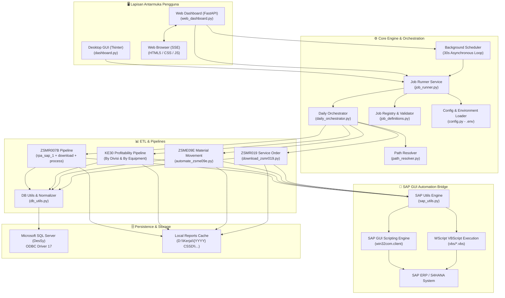

# 🚀 Automatic SAP – Service Performance & Scoring Automation Platform

<div align="center">

[](https://www.python.org/)
[](https://fastapi.tiangolo.com/)
[](https://www.sap.com/)
[](https://www.microsoft.com/sql-server)
[](LICENSE)
[](https://github.com/kodok-ijho/AutomaticSAP-ServPerfAndScoring)

**Platform Robotic Process Automation (RPA) & ETL Tingkat Enterprise untuk Ekstraksi, Transformasi, dan Sinkronisasi Data SAP ERP ke Microsoft SQL Server secara Otomatis.**

[📖 Buku Panduan (Manual Book)](docs/MANUAL_BOOK.md) • [🏛️ Dokumen Teknis (Technical Architecture)](docs/TECHNICAL.md) • [📋 Daftar Spesifikasi Job](docs/jobs.md) • [✅ Checklist Harian](docs/checklist_harian.md)

</div>

---

## 🌟 Ikhtisar Proyek (Project Overview)

**AutomaticSAP-ServPerfAndScoring** mengotomatiskan seluruh siklus ekstraksi laporan SAP ERP (Service Performance, Equipment Profitability, Material Movements, dan Maintenance Orders). Sistem ini menjembatani API Scripting SAP GUI, pemrosesan paralel berbasis Python, sanitasi data angka desimal format Eropa/SAP, dan pengunggahan *high-performance batch* ke Microsoft SQL Server.

Sistem ini dirancang dengan arsitektur modern yang memisahkan lapisan bisnis dan UI, menyediakan **dua mode antarmuka mandiri**:
1. 🖥️ **Desktop GUI (Tkinter)** — Aplikasi desktop berbasis thread untuk workstation operator.
2. 🌐 **Web Dashboard (FastAPI + SSE)** — Antarmuka web responsif bertema *Dark Obsidian & SAP Blue* dengan log streaming real-time via Server-Sent Events.

---

## ⚡ Fitur Utama (Key Features)

- ⭐ **Otomatisasi Harian Terpadu (Daily E2E Pipeline)**: Eksekusi 1-Click / Terjadwal 6 Tahap (Create BG 007B batch 1.000 eq, Download & Upsert 007B, KE30 Divisi, KE30 Eq, ZSME09E, ZSMR019) dengan resolusi path dinamis otomatis ke `D:\Kerja\`.
- 🤖 **Orkestrasi SAP Otomatis**: Mendukung eksekusi VBScript terisolasi (`wscript.exe`), deteksi session aktif, penanganan modal popup multi-login (`wnd[1]`), dan mekanisme auto-login terintegrasi.
- 🗄️ **Resilient Database Layer**: Koneksi `pyodbc` dengan *exponential retry*, penghapusan data per periode otomatis (*idempotent cleanup*), dan pengunggahan *batch chunking* (1.000 baris/chunk) dengan `fast_executemany` untuk mencegah buffer deadlock.
- 🧹 **Pembersihan & Normalisasi Angka SAP Universal**: Normalisasi otomatis format angka khas SAP (koma desimal `1.234,56` ➔ `1234.56`, tanda minus di belakang `322.361-` ➔ `-322361.0`, dan deteksi encoding dinamis `UTF-16`/`UTF-8`/`CP1252`).
- ⏱️ **Penjadwalan Otomatis (Cron & Windows Task Scheduler)**: Mendukung penjadwalan via Dashboard loop maupun eksekusi mandiri headless via `run_daily.bat`.
- 📡 **Live Stream Logging & Categorization**: Klasifikasi tag output (`ERROR`, `OK`, `WARN`, `INFO`) dengan pewarnaan terminal interaktif di desktop dan web dashboard.
- 🛡️ **Zero-Trust Credential Architecture**: Kredensial sensitif diisolasi penuh di file `.env`, tidak pernah disimpan di source code maupun file JSON konfigurasi runtime.

---

## 📐 Arsitektur Sistem (System Architecture)



---

## 🗂️ Modul & Alur Otomatisasi (Job Pipelines)

| No | Modul / Job | Script Pelaksana | Deskripsi & Target Data |
|:---|:---|:---|:---|
| ⭐ | **DAILY AUTOMATION PIPELINE (6 Stages)** | [`daily_orchestrator.py`](file:///D:/Kerja/Application%20AG/SAP%20AUTOMATION/daily_orchestrator.py) | **Otomatisasi Harian Terpadu**: Menjalankan 6 Tahap sekaligus secara otomatis dengan auto-folder di `D:\Kerja\`. |
| 1 | **CREATE BG JOB ZSMR007B** | [`rpa_sap_1.py`](file:///D:/Kerja/Application%20AG/SAP%20AUTOMATION/rpa_sap_1.py) | Mengambil equipment dari `Tb_R_SerPervEq`, salin clipboard batch (1.000 eq/batch), jadwalkan BG Job di SAP. |
| 2 | **DOWNLOAD BG JOB ZSMR007B** | [`download_zsmr007b.py`](file:///D:/Kerja/Application%20AG/SAP%20AUTOMATION/download_zsmr007b.py) | Mengunduh spool hasil BG Job SAP ke file lokal `*1.txt` & `*2.txt`. |
| 3 | **MERAPIHKAN HASIL ZSMR007B** | [`process_reports.py`](file:///D:/Kerja/Application%20AG/SAP%20AUTOMATION/process_reports.py) | Membersihkan data, menggabungkan (*inner join* Equipment), dan mengunggah ke tabel `ZSMR007B`. |
| 4 | **DOWNLOAD LAPORAN KE30 (Divisi)** | [`download_ke30.py`](file:///D:/Kerja/Application%20AG/SAP%20AUTOMATION/download_ke30.py) | Mengunduh laporan Profitability Analysis KE30 seluruh divisi dari SAP GUI. |
| 5 | **PERAPIHAN KE30 (Divisi)** | [`ProsesKE30byDiv.py`](file:///D:/Kerja/Application%20AG/SAP%20AUTOMATION/ProsesKE30byDiv.py) | Memproses file `.dat` via Excel COM, menyematkan mapping divisi bisnis, dan upload ke tabel `KE30`. |
| 6 | **DOWNLOAD LAPORAN KE30 (Equipment)**| [`download_ke30_eq.py`](file:///D:/Kerja/Application%20AG/SAP%20AUTOMATION/download_ke30_eq.py) | Mengunduh laporan KE30 rincian equipment dari SAP GUI. |
| 7 | **PERAPIHAN KE30 (Equipment)**| [`ProcessKE30byEq.py`](file:///D:/Kerja/Application%20AG/SAP%20AUTOMATION/ProcessKE30byEq.py) | Memisahkan Equipment/Material/Serial Number, normalisasi 13 metrik, dan upload ke tabel `KE30_ByEq`. |
| 8 | **ZSME09E AUTOMATION** | [`automate_zsme09e.py`](file:///D:/Kerja/Application%20AG/SAP%20AUTOMATION/automate_zsme09e.py) | Mengunduh data material return ZSME09E dari SAP, simpan Excel audit, dan upload ke tabel `ZSME09E`. |
| 9 | **DOWNLOAD LAPORAN ZSMR019** | [`download_zsmr019.py`](file:///D:/Kerja/Application%20AG/SAP%20AUTOMATION/download_zsmr019.py) | Mengunduh 32 kolom Service Order & Notification ZSMR019 dan upload ke tabel `ZSMR019`. |

---

## 💻 Panduan Instalasi & Penggunaan (Getting Started)

### 1. Prasyarat Sistem
- **Windows 10 / 11 / Server** (64-bit)
- **Python 3.10+** (pastikan mencentang *"Add Python to PATH"*)
- **SAP GUI 7.70 / 8.00** dengan fitur Scripting aktif (*Options > Accessibility & Scripting > Scripting > Enable scripting*)
- **Microsoft ODBC Driver 17 for SQL Server**
- **Microsoft Excel**

### 2. Instalasi Proyek
```powershell
# 1. Masuk ke direktori proyek
cd "D:\Kerja\Application AG\SAP AUTOMATION"

# 2. Buat virtual environment
python -m venv venv

# 3. Aktifkan virtual environment
.\venv\Scripts\activate

# 4. Pasang seluruh pustaka dependensi
pip install -r requirements.txt

# 5. Jalankan automated smoke test
python test_smoke.py
```

### 3. Konfigurasi Lingkungan (`.env`)
Salin file `.env.example` menjadi `.env` lalu sesuaikan kredensial Anda:
```env
SAP_USERNAME=your_username
SAP_PASSWORD=your_password
SAP_CONNECTION=SAP HANA AGDS PROD

DB_SERVER=172.31.151.88
DB_NAME=DesSy
DB_USER=your_db_user
DB_PASSWORD=your_db_password
DB_DRIVER=ODBC Driver 17 for SQL Server
```

---

## 🚀 Cara Menjalankan Aplikasi

### Mode 1: Desktop GUI (Tkinter)
```powershell
python dashboard.py
```

### Mode 2: Web Dashboard (FastAPI)
```powershell
python web_dashboard.py
```
Buka browser dan kunjungi: **`http://localhost:8000`**

---

## 📚 Dokumentasi Lengkap

Untuk panduan pengoperasian yang lebih mendalam, silakan baca dokumentasi pendukung berikut:

- 📖 **[Manual Book (Buku Panduan Pengguna)](docs/MANUAL_BOOK.md)** — Panduan langkah demi langkah lengkap untuk seluruh modul, SOP closing bulanan, penjadwalan, dan FAQ.
- 🏛️ **[Dokumentasi Arsitektur Teknis (Technical Docs)](docs/TECHNICAL.md)** — Referensi mendalam arsitektur perangkat lunak, skema database, modul shared, dan resilience pattern.
- 📋 **[Daftar Parameter & Perintah CLI (Jobs Reference)](docs/jobs.md)** — Kartu ringkasan perintah CLI untuk masing-masing job tanpa GUI.
- ✅ **[Checklist Operasi Harian & Bulanan](docs/checklist_harian.md)** — Lembar periksa operator untuk memastikan keabsahan data SQL saat closing.

---

## 🧪 Pengujian Unit & Smoke Test

Aplikasi menyertakan rangkaian pengujian otomatis tanpa memerlukan koneksi database atau SAP GUI aktif:
```powershell
python test_smoke.py
```

---

## 🔒 Keamanan & Kebijakan Data
- File kredensial `.env` dan file cache `job_config.json` di-ignore secara default melalui `.gitignore`.
- Password database dan SAP **tidak pernah** disimpan dalam plaintext di dalam file konfigurasi JSON.
- Eksekusi VBScript menggunakan `shell=False` (`subprocess.run(["wscript.exe", ...])`) untuk mencegah injeksi perintah shell.

---

## 📄 Lisensi
Hak Cipta © 2026. Didistribusikan di bawah lisensi internal / MIT License.
