# 📖 Manual Book — Panduan Operasional Pengguna
## Sistem Otomatisasi SAP GUI & Service Performance Scoring

> **Panduan Resmi Pengoperasian Aplikasi untuk Tim Operasional, Data Engineer, dan Analis.**  
> **Versi Dokumen:** `1.0.0`

---

## 📑 Daftar Isi

1. [Pendahuluan](#1-pendahuluan)
2. [Prasyarat Sistem & Persiapan Lingkungan](#2-prasyarat-sistem--persiapan-lingkungan)
   - [2.1 Kebutuhan Perangkat Lunak](#21-kebutuhan-perangkat-lunak)
   - [2.2 Mengaktifkan SAP GUI Scripting](#22-mengaktifkan-sap-gui-scripting)
   - [2.3 Konfigurasi File Kredensial (`.env`)](#23-konfigurasi-file-kredensial-env)
3. [Instalasi Aplikasi](#3-instalasi-aplikasi)
4. [Panduan Menggunakan Desktop Dashboard (Tkinter)](#4-panduan-menggunakan-desktop-dashboard-tkinter)
5. [Panduan Menggunakan Web Dashboard (Modern Web UI)](#5-panduan-menggunakan-web-dashboard-modern-web-ui)
6. [Panduan Eksekusi Job & Modul Otomatisasi](#6-panduan-eksekusi-job--modul-otomatisasi)
   - [6.0 Job Utama: DAILY AUTOMATION PIPELINE (Full 6 Stages)](#60-job-utama-daily-automation-pipeline-full-6-stages)
   - [6.1 Job 1: CREATE BG JOB ZSMR007B – Equipment Batch Clipboard](#61-job-1-create-bg-job-zsmr007b--equipment-batch-clipboard)
   - [6.2 Job 2: DOWNLOAD BG JOB ZSMR007B – SAP Background Job](#62-job-2-download-bg-job-zsmr007b--sap-background-job)
   - [6.3 Job 3: MERAPIHKAN HASIL DOWNLOAD – ZSMR007B](#63-job-3-merapihkan-hasil-download--zsmr007b)
   - [6.4 Job 4: DOWNLOAD LAPORAN KE30 – By Divisi](#64-job-4-download-laporan-ke30--by-divisi)
   - [6.5 Job 5: PERAPIHAN LAPORAN KE30 – By Divisi](#65-job-5-perapihan-laporan-ke30--by-divisi)
   - [6.6 Job 6: DOWNLOAD LAPORAN KE30 – By Eq](#66-job-6-download-laporan-ke30--by-eq)
   - [6.7 Job 7: PERAPIHAN LAPORAN KE30 – By Eq](#67-job-7-perapihan-laporan-ke30--by-eq)
   - [6.8 Job 8: ZSME09E AUTOMATION – Login, Process, & SQL](#68-job-8-zsme09e-automation--login-process--sql)
   - [6.9 Job 9: DOWNLOAD LAPORAN ZSMR019 – SAP GUI Report](#69-job-9-download-laporan-zsmr019--sap-gui-report)
7. [SOP Alur Kerja Closing Bulanan (Standard Operating Procedure)](#7-sop-alur-kerja-closing-bulanan-standard-operating-procedure)
8. [Panduan Fitur Penjadwalan Otomatis (Scheduler)](#8-panduan-fitur-penjadwalan-otomatis-scheduler)
9. [Fitur Diagnostik (Test SAP & Test DB)](#9-fitur-diagnostik-test-sap--test-db)
10. [Panduan Troubleshooting & Solusi Masalah Umum](#10-panduan-troubleshooting--solusi-masalah-umum)

---

## 1. Pendahuluan

Aplikasi **AutomaticSAP-ServPerfAndScoring** adalah perangkat lunak otomasi proses robotik (RPA) berbasis Python dan VBScript yang dirancang untuk mengotomatiskan seluruh siklus ekstraksi laporan SAP ERP, pembersihan data (data sanitization), kalkulasi metrik kinerja servis, dan sinkronisasi ke database Microsoft SQL Server (`DesSy`).

Aplikasi ini hadir dengan **dua mode antarmuka**:
1. **Desktop GUI (Tkinter)**: Aplikasi desktop mandiri yang stabil dan ringan.
2. **Web Dashboard (FastAPI)**: Antarmuka web modern dengan streaming log real-time dan akses browser lokal/jaringan.

---

## 2. Prasyarat Sistem & Persiapan Lingkungan

### 2.1 Kebutuhan Perangkat Lunak
Sebelum menjalankan aplikasi, pastikan komputer Anda telah terpasang:
1. **Sistem Operasi**: Windows 10, Windows 11, atau Windows Server (64-bit).
2. **Python 3.10 atau versi lebih baru**: [Download Python](https://www.python.org/downloads/)  
   *(Wajib centang opsi **"Add Python to PATH"** saat instalasi).*
3. **SAP GUI 7.70 / 8.00**: Sudah terpasang dan memiliki akses ke server SAP perusahaan.
4. **Microsoft ODBC Driver 17 for SQL Server**: Diperlukan untuk komunikasi database.  
   [Download ODBC Driver 17](https://learn.microsoft.com/en-us/sql/connect/odbc/download-odbc-driver-for-sql-server)
5. **Microsoft Excel**: Dibutuhkan untuk modul perapihan format `.dat` melalui Excel COM.
6. **Akses Jaringan**: Komputer harus terhubung ke jaringan kantor (LAN/VPN) agar dapat menjangkau server database (`172.31.151.88`) dan server SAP.

---

### 2.2 Mengaktifkan SAP GUI Scripting
Fitur otomatisasi membutuhkan API SAP GUI Scripting aktif di komputer operator:
1. Buka aplikasi **SAP Logon**.
2. Klik ikon menu di pojok kiri atas jendela SAP Logon, lalu pilih **Options** (atau tekan `Alt + F12` lalu pilih *Options*).
3. Navigasikan ke menu **Accessibility & Scripting** ➔ **Scripting**.
4. Berikan centang pada opsi:
   - ✅ **Enable scripting**
5. Hilangkan centang pada opsi notifikasi berikut (agar tidak muncul popup konfirmasi setiap kali robot berjalan):
   - ❌ *Notify when a script attaches to SAP GUI*
   - ❌ *Notify when a script opens a connection*
6. Klik **Apply** lalu **OK**.

> ⚠️ **Catatan Penting:** Jika menu scripting dinonaktifkan (berwarna abu-abu) atau muncul pesan *DisabledByServer*, hubungi tim SAP Basis perusahaan untuk mengaktifkan parameter `sapgui/user_scripting = TRUE` di server SAP.

---

### 2.3 Konfigurasi File Kredensial (`.env`)

Untuk keamanan, kredensial password **tidak pernah disimpan di dalam source code**. Anda wajib membuat file bernama `.env` di folder utama aplikasi.

#### Langkah Pembuatan:
1. Salin file `.env.example` dan ubah namanya menjadi `.env`.
2. Buka file `.env` menggunakan Notepad atau text editor lain.
3. Isi dengan kredensial SAP dan Database yang valid:

```env
# ------------------------------------------------------------------------------
# SAP Credentials
# ------------------------------------------------------------------------------
SAP_USERNAME=2436dyu
SAP_PASSWORD=PasswordSAPAndaYangSebenarnya!
SAP_CONNECTION=SAP HANA AGDS PROD

# ------------------------------------------------------------------------------
# Database (SQL Server)
# ------------------------------------------------------------------------------
DB_SERVER=172.31.151.88
DB_NAME=DesSy
DB_USER=dessyuser
DB_PASSWORD=PasswordDatabaseAnda!
DB_DRIVER=ODBC Driver 17 for SQL Server
```

> 🔒 **Peringatan Keamanan:** File `.env` bersifat rahasia dan sudah terdaftar di `.gitignore`. Jangan pernah membagikan atau mengupload file ini ke Git publik.

---

## 3. Instalasi Aplikasi

1. **Buka Terminal / PowerShell** di direktori proyek:
   ```powershell
   cd "D:\Kerja\Application AG\SAP AUTOMATION"
   ```

2. **Buat Lingkungan Virtual Python (Virtual Environment)**:
   ```powershell
   python -m venv venv
   ```

3. **Aktifkan Virtual Environment**:
   ```powershell
   .\venv\Scripts\activate
   ```

4. **Instal Seluruh Dependensi Paket**:
   ```powershell
   pip install -r requirements.txt
   ```

5. **Uji Validitas Instalasi (Smoke Test)**:
   ```powershell
   python test_smoke.py
   ```
   *Jika muncul tulisan `Ran 16 tests ... OK`, maka sistem siap digunakan.*

---

## 4. Panduan Menggunakan Desktop Dashboard (Tkinter)

Aplikasi Desktop Dashboard cocok untuk penggunaan harian di workstation lokal operator.

### 🚀 Cara Menjalankan
Pastikan terminal berada pada virtual environment, lalu jalankan:
```powershell
python dashboard.py
```

### 🖼️ Struktur Antarmuka Desktop

```
+--------------------------------------------------------------------------------+
|  SAP Automation Dashboard – Service Performance                 [Test SAP] [Exit] |
+--------------------------------------------------------------------------------+
| [TOOLBAR]  ▶ Execute Job   ⏹ Stop Job   💾 Save Config   🔄 Refresh   🔍 Test DB |
+------------------------------------+-------------------------------------------+
| DAFTAR JOB (Sebelah Kiri)          | FORM PARAMETER (Sebelah Kanan)            |
| ---------------------------------- | ----------------------------------------- |
| ▶ 1. CREATE BG JOB ZSMR007B        | Periode:        [ 2026-06-01       ] [📅] |
| ▶ 2. DOWNLOAD BG JOB ZSMR007B      | Max Offset:     [ 1000             ]      |
| ▶ 3. MERAPIHKAN HASIL ZSMR007B     | Batch Size:     [ 500              ]      |
| ▶ 4. DOWNLOAD LAPORAN KE30 (Div)   | Delay (detik):  [ 10               ]      |
| ▶ 5. PERAPIHAN KE30 (By Divisi)    | Path VBS:       [ vbs\CreateBG...  ] [📂] |
| ▶ 6. DOWNLOAD LAPORAN KE30 (Eq)    | Sched BG Start: [ 18:00            ]      |
| ▶ 7. PERAPIHAN KE30 (By Eq)        | ----------------------------------------- |
| ▶ 8. ZSME09E AUTOMATION            | Sch Time (HH:mm)[ 06:00            ]      |
| ▶ 9. DOWNLOAD LAPORAN ZSMR019      | Sch Active:     [ True / False     ]      |
+------------------------------------+-------------------------------------------+
| LOG EXECUTION CONSOLE (Real-Time Terminal Output)                              |
| [14:02:10] [INFO] Memulai eksekusi job ZSMR019...                              |
| [14:02:15] [OK] File hasil export terverifikasi: ZSMR019 - 0626.txt (145.2 KB)  |
| [14:02:18] [SQL SUCCESS] Berhasil memperbarui 1.250 baris data ke database.    |
+--------------------------------------------------------------------------------+
```

### 🔘 Fungsi Tombol Desktop
- **Execute Job (F5)**: Menjalankan job yang sedang dipilih dengan parameter yang tertera di form.
- **Stop Job**: Menghentikan proses yang sedang berjalan seketika beserta child-process (SAP/Excel).
- **Save Config**: Menyimpan perubahan parameter form ke `job_config.json`.
- **Test SAP**: Mengecek kesiapan SAP GUI Scripting dan mendeteksi session login.
- **Test DB**: Menguji koneksi ke SQL Server.

---

## 5. Panduan Menggunakan Web Dashboard (Modern Web UI)

Web Dashboard menawarkan tampilan gelap (dark theme) bergaya modern dengan pemantauan berbasis browser dan streaming log Server-Sent Events (SSE).

### 🚀 Cara Menjalankan
```powershell
python web_dashboard.py
```
Setelah server aktif, buka browser favorit Anda (Chrome, Edge, Firefox) dan akses:
👉 **`http://localhost:8000`** atau **`http://127.0.0.1:8000`**

### ✨ Keunggulan Web Dashboard:
- **Responsive Layout**: Panel daftar job, form editor, dan terminal console interaktif.
- **Live Stream Logs**: Log output dari subprocess dialirkan langsung tanpa perlu me-refresh halaman.
- **Background Scheduler**: Scheduler otomatis tetap aktif berjalan di background loop FastAPI.
- **Built-in File Browser**: Tombol browse (`📂`) langsung memanggil native file/folder selector Windows.
- **Real-time Status Pill**: Badge status job berganti dinamis (`IDLE` ⚪, `RUNNING` 🔵, `SUCCESS` 🟢, `FAILED` 🔴).

---

## 6. Panduan Eksekusi Job & Modul Otomatisasi

### 6.0 Job Utama: DAILY AUTOMATION PIPELINE (Full 6 Stages)
- **Fungsi**: Eksekusi terpadu 1-Click yang merantai seluruh 6 tahapan secara otomatis:
  1. Membuat BG Job ZSMR007B per 1.000 equipment di SAP.
  2. Download spool ZSMR007B ➔ merge `*1` & `*2` ➔ upsert ke tabel `ZSMR007B`.
  3. Download KE30 Divisi ➔ Excel COM normalizer ➔ upsert ke tabel `KE30`.
  4. Download KE30 Equipment ➔ parse composite string ➔ upsert ke tabel `KE30_ByEq`.
  5. Download ZSME09E Material Movement ➔ upsert ke tabel `ZSME09E`.
  6. Download ZSMR019 Service Order ➔ upsert ke tabel `ZSMR019`.
- **Fitur Khusus**:
  - **Auto Dynamic Workspace Path**: Otomatis mendeteksi dan membuat struktur folder di `D:\Kerja\` (`{YYYY} CSSD`, `02. REPORTING {YYYY}`, `03. KE30`).
  - **Pre-flight Variable Inspector**: Menampilkan tabel konfirmasi semua path dan closing dates sebelum dieksekusi.
- **Parameter Utama**:
  - `Target Periode`: Tanggal periode (Default: auto-detect dari tabel `Tb_R_PeriodeClosing`).
  - `Base Drive Work`: Root folder kerja (Default: `D:\Kerja`).
  - `Pilihan Tahap`: Tahapan yang ingin dijalankan (Default: `1,2,3,4,5,6`).
  - `Batch Size Eq`: Ukuran batch equipment untuk Tahap 1 (Default: `1000`).

---

### 6.1 Job 1: CREATE BG JOB ZSMR007B – Equipment Batch Clipboard
- **Fungsi**: Mengambil data nomor Equipment dari database tabel `Tb_R_SerPervEq` untuk periode yang dipilih, membaginya ke dalam batch clipboard (1.000 equipment per batch), lalu menjadwalkan Background Job di SAP melalui VBScript.
- **Parameter Utama**:
  - `Periode`: Tanggal periode data (Format `YYYY-MM-DD`, contoh: `2026-06-01`).
  - `Max Offset`: Batas atas baris data (isi `0` untuk memproses seluruh equipment di database).
  - `Batch Size`: Jumlah peralatan per batch clipboard (default: `1000`).
  - `Delay (detik)`: Jeda waktu istirahat antar batch (default: `10`).
  - `Sched BG Start`: Jam mulai eksekusi Background Job di server SAP (contoh: `18:00`).

---

### 6.2 Job 2: DOWNLOAD BG JOB ZSMR007B – SAP Background Job
- **Fungsi**: Membaca periode closing aktif dari database `Tb_R_PeriodeClosing`, lalu mengekstrak hasil Background Job SAP (spool) dan menyimpannya ke folder lokal.
- **Parameter Utama**:
  - `Tanggal (To Date)`: Tanggal akhir transaksi (`dd.MM.yyyy`). Default: otomatis tanggal hari ini (`dynamic-today-dmy`).
  - `Periode Override`: (Opsional) Mengabaikan periode database dan memakai periode manual (`YYYY-MM-DD`).
  - `Save Path`: Direktori tempat menyimpan file download (contoh: `D:\Kerja\SS\`).

---

### 6.3 Job 3: MERAPIHKAN HASIL DOWNLOAD – ZSMR007B
- **Fungsi**: Membaca kumpulan file teks hasil download SAP (`*1.txt` dan `*2.txt`), merapikan delimiter pipe, membersihkan format angka ribuan/desimal, menggabungkan data (*merge on Equipment*), membuat file Excel konsolidasi, dan mengunggahnya ke tabel `ZSMR007B`.
- **Parameter Utama**:
  - `Folder Laporan`: Folder yang berisi file `.txt` ZSMR007B.
  - `Insert ke SQL`: Atur ke `True` untuk mengupload hasil gabungan ke database SQL Server.

---

### 6.4 Job 4: DOWNLOAD LAPORAN KE30 – By Divisi
- **Fungsi**: Mengunduh seluruh laporan Profitability Analysis KE30 untuk semua divisi dari SAP GUI ke dalam file mentah `.dat`.
- **Parameter Utama**:
  - `Periode`: Format `YYYY-MM-DD`.
  - `Save Path`: Folder target penyimpanan file download `.dat`.

---

### 6.5 Job 5: PERAPIHAN LAPORAN KE30 – By Divisi
- **Fungsi**: Membaca file `.dat` KE30 per divisi via Excel COM, menyematkan mapping divisi bisnis (EDS, GCS, DtM), menambahkan 20 parameter metrik finansial, membuat file `Combined_KE30_<periode>.xlsx` dan `Combined_KE30_<periode>.txt`, serta mengunggahnya ke tabel SQL `KE30`.
- **Parameter Utama**:
  - `Folder Laporan`: Folder lokasi file-file `.dat` KE30 divisi disimpan.
  - `Periode`: Tanggal target periode (`YYYY-MM-DD`).
  - `Insert ke SQL`: Atur ke `True` untuk mengupload ke database.

---

### 6.6 Job 6: DOWNLOAD LAPORAN KE30 – By Eq
- **Fungsi**: Mengunduh laporan KE30 dengan rincian per nomor Equipment dari SAP GUI.
- **Parameter Utama**:
  - `Periode`: Format `YYYY-MM-DD`.
  - `Save Path`: Folder tujuan penyimpanan file download.

---

### 6.7 Job 7: PERAPIHAN LAPORAN KE30 – By Eq
- **Fungsi**: Memproses file laporan KE30 Equipment, memisahkan string gabungan menjadi `Equipment`, `Material`, dan `SerialNumber`, membersihkan 13 metrik numerik, menghasilkan file `Combined_KE30_ByEq_<periode>.txt`, dan mengunggah ke tabel SQL `KE30_ByEq`.
- **Parameter Utama**:
  - `File Laporan`: Path lengkap ke file tunggal `.dat` KE30 By Eq.
  - `Periode`: Format `YYYY-MM-DD`.
  - `Insert ke SQL`: Atur ke `True` untuk mengunggah ke database.

---

### 6.8 Job 8: ZSME09E AUTOMATION – Login, Process, & SQL
- **Fungsi**: Mengambil rentang tanggal transaksi dari `Tb_R_PeriodeClosing`, menjalankan download laporan material return ZSME09E dari SAP, memfilter baris summary, menyimpan salinan Excel, dan memperbarui tabel SQL `ZSME09E`.
- **Parameter Utama**:
  - `Periode`: Format `YYYY-MM-DD` (wajib terdaftar di tabel `Tb_R_PeriodeClosing`).
  - `Save Path`: Folder lokasi file output.

---

### 6.9 Job 9: DOWNLOAD LAPORAN ZSMR019 – SAP GUI Report
- **Fungsi**: Mengambil tanggal `StartDate` dan `EndDate` dari tabel closing, menjalankan VBScript ZSMR019, memberi nama file otomatis (`ZSMR019 - MMyy - ddMMyy.txt`), memparsing 32 kolom notifikasi & service order, menghapus data periode lama, dan menginsert data baru ke tabel `ZSMR019`.
- **Parameter Utama**:
  - `Periode`: Format `YYYY-MM-DD` (misal: `2026-06-01`).
  - `Insert ke SQL`: Atur ke `True` untuk menyimpan ke database.

---

## 7. SOP Alur Kerja Closing Bulanan (Standard Operating Procedure)

Untuk memastikan integritas data antar tabel, ikuti urutan eksekusi berikut saat melakukan proses closing bulanan:

```mermaid
flowchart TD
    S0["🏁 Mulai Closing Bulanan"] --> S1["1. Pastikan SAP Logon Terbuka & Login"]
    S1 --> S2["2. Pastikan Jaringan / VPN Database Terhubung"]
    S2 --> J1["Job 1: CREATE BG JOB ZSMR007B\n(Jadwalkan Background Job di SAP)"]
    J1 --> W1["⏳ Tunggu Background Job SAP Selesai di SM37"]
    W1 --> J2["Job 2: DOWNLOAD BG JOB ZSMR007B\n(Ekstrak spool file ke folder lokal)"]
    J2 --> J3["Job 3: MERAPIHKAN HASIL DOWNLOAD ZSMR007B\n(Merge *1 & *2, Upload ke Tb ZSMR007B)"]
    J3 --> J4["Job 4: DOWNLOAD LAPORAN KE30 (By Divisi)\n(Unduh file .dat seluruh divisi)"]
    J4 --> J5["Job 5: PERAPIHAN LAPORAN KE30 (By Divisi)\n(Excel COM ETL & Upload ke Tb KE30)"]
    J5 --> J6["Job 6: DOWNLOAD LAPORAN KE30 (By Eq)\n(Unduh file .dat rincian equipment)"]
    J6 --> J7["Job 7: PERAPIHAN LAPORAN KE30 (By Eq)\n(Parse Eq & Upload ke Tb KE30_ByEq)"]
    J7 --> J8["Job 8: ZSME09E AUTOMATION\n(Download & Upload Material Return ke Tb ZSME09E)"]
    J8 --> J9["Job 9: DOWNLOAD LAPORAN ZSMR019\n(Download & Upload Service Order ke Tb ZSMR019)"]
    J9 --> V1["🔍 Verifikasi Row Count di Database SQL Server"]
    V1 --> END["🎉 Selesai Closing Sukses!"]
```



---

## 8. Panduan Fitur Penjadwalan Otomatis (Scheduler)

Aplikasi menyediakan dua metode penjadwalan:

### 8.1 Penjadwalan Windows Task Scheduler (Direkomendasikan untuk Laptop / Background)
Untuk pengguna laptop di mana laptop dimatikan pada akhir pekan / hari libur:
1. Buka PowerShell dan jalankan:
   ```powershell
   powershell -ExecutionPolicy Bypass -File setup_scheduler.ps1
   ```
2. Skrip otomatis mendaftarkan task **`SAP_Automation_Daily_Pipeline`** ke Windows Task Scheduler dengan aturan:
   - **Jadwal**: Setiap Senin s/d Jumat pukul **08:00 Pagi**.
   - **Fitur Laptop *"Start When Available"***: Jika laptop Anda baru dinyalakan setelah pukul 08:00 (misal 08:30), task akan **langsung otomatis dieksekusi begitu laptop aktif dan terhubung ke jaringan kantor/VPN**.
   - **Log Otomatis**: Setiap proses otomatis mencatat riwayat eksekusi di folder `logs/`.

### 8.2 Smart Spool Lookback di Hari Senin
Sistem memiliki kecerdasan tanggal otomatis:
- **Selasa s/d Jumat**: Menarik spool `H-1` (kemarin sore jam 17:00).
- **Hari Senin**: Otomatis mundur **`H-3` (Jumat sore jam 17:00)** sehingga hasil eksekusi akhir pekan tidak hilang.

### 8.3 Penjadwalan Internal Dashboard (Opsional)
1. Pilih Job yang ingin dijadwalkan.
2. Pada bagian bawah form parameter:
   - **`Sch Time`**: Masukkan jam eksekusi dalam format 24 jam `HH:mm` (contoh: `08:00`).
   - **`Sch Active`**: Pilih / isi `True`.
3. Klik tombol **Save Config** (💾).

> ⚠️ **CATATAN:** Jika menggunakan penjadwalan internal Dashboard, aplikasi (Desktop atau Web Dashboard) harus tetap menyala / running di laptop. Jika ingin headless tanpa membuka dashboard, gunakan Task Scheduler (Opsi 8.1).

---

## 9. Fitur Diagnostik (Test SAP & Test DB)

### 🔍 Tombol "Test SAP"
Digunakan untuk memvalidasi engine scripting SAP sebelum menjalankan job otomatisasi.
- **Hasil Sukses**: Menampilkan jumlah koneksi aktif, jumlah session, dan pesan `Session aktif & sudah login. Scripting OK.`
- **Hasil Gagal**: Memberitahu letak kendala (misal: SAP Logon belum dibuka, masih di layar login, atau scripting diblokir server).

### 🔍 Tombol "Test DB"
Memeriksa status konektivitas jaringan dan keabsahan kredensial SQL Server.
- Menampilkan status ping koneksi dan daftar database aktif jika berhasil.

---

## 10. Panduan Troubleshooting & Solusi Masalah Umum

| Gejala / Pesan Error | Penyebab | Solusi Tindakan |
| :--- | :--- | :--- |
| **`[CONFIG ERROR] Variabel 'DB_PASSWORD' tidak ditemukan`** | File `.env` belum dibuat atau password kosong. | Salin `.env.example` menjadi `.env` lalu isi kredensial yang benar. |
| **`SAP GUI tidak aktif / scripting engine tidak tersedia`** | Aplikasi SAP Logon belum dibuka di Windows. | Buka SAP Logon, login dengan user Anda, lalu coba lagi. |
| **`SCRIPTING DIBLOKIR SERVER (DisabledByServer=True)`** | Pengaturan server SAP menolak scripting. | Hubungi tim SAP Basis untuk mengaktifkan parameter `sapgui/user_scripting=TRUE`. |
| **`SAP masih di layar login`** | SAP GUI terbuka namun belum menyelesaikan autentikasi. | Masukkan username/password di layar SAP atau gunakan tombol Auto-Login. |
| **`Koneksi gagal: [08001] [Microsoft][ODBC Driver 17...]`** | Komputer tidak dapat menjangkau server database. | Pastikan kabel LAN terpasang atau sambungan VPN kantor aktif. |
| **`File hasil download berukuran 0 byte (kosong)`** | Transaksi SAP tidak menghasilkan data atau export terpotong. | Periksa tanggal filter di SAP, pastikan data transaksi tersedia untuk periode tersebut. |
| **`Modul pywin32 belum terinstall`** | Virtual environment belum lengkap. | Jalankan perintah `pip install pywin32` di terminal. |

---

## 📞 Bantuan & Dukungan Teknis

Jika mengalami kendala operasional yang tidak tercantum dalam panduan ini, silakan hubungi tim pengembang atau buat *issue* pada repositori GitHub resmi:  
🔗 **[GitHub Repository: AutomaticSAP-ServPerfAndScoring](https://github.com/kodok-ijho/AutomaticSAP-ServPerfAndScoring)**
