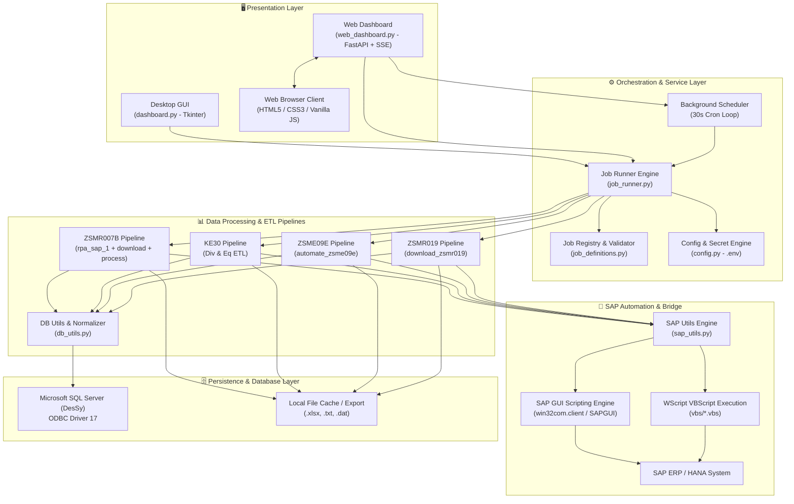
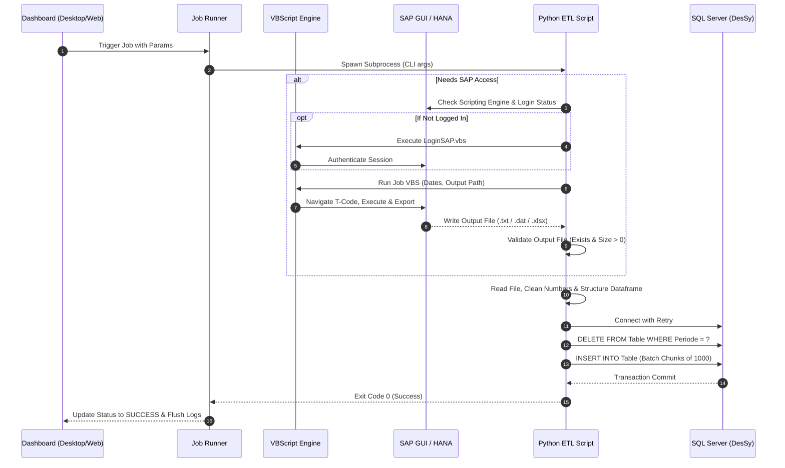
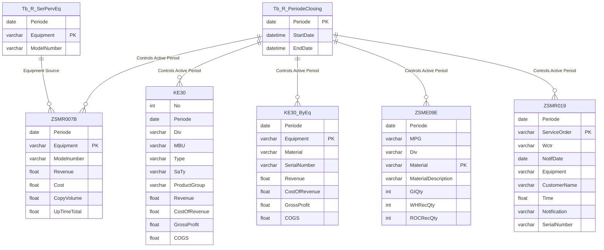

# 🏛️ Technical Documentation & Architecture Reference
## SAP Automation & Service Performance Scoring System

> **Version:** `1.0.0`  
> **Target Platform:** Windows 10/11 / Windows Server  
> **Core Stack:** Python 3.10+, SAP GUI Scripting COM API, VBScript (WScript), FastAPI, Tkinter, PyODBC, SQL Server, Pandas, OpenPyXL  

---

## 📑 Table of Contents

1. [System Overview & Architecture](#1-system-overview--architecture)
2. [Component Architecture & Directory Layout](#2-component-architecture--directory-layout)
3. [Core Shared Modules](#3-core-shared-modules)
   - [3.1 `config.py` — Centralized Security & Environment](#31-configpy--centralized-security--environment)
   - [3.2 `sap_utils.py` — SAP GUI Automation & COM Bridge](#32-sap_utilspy--sap-gui-automation--com-bridge)
   - [3.3 `db_utils.py` — Resilient Database Layer & ETL Normalization](#33-db_utilspy--resilient-database-layer--etl-normalization)
   - [3.4 `job_definitions.py` — Single Source of Truth (SSOT)](#34-job_definitionspy--single-source-of-truth-ssot)
   - [3.5 `job_runner.py` — Unified Process Execution Engine](#35-job_runnerpy--unified-process-execution-engine)
4. [User Interfaces & Dual Modes](#4-user-interfaces--dual-modes)
   - [4.1 Desktop GUI (`dashboard.py`)](#41-desktop-gui-dashboardpy)
   - [4.2 Web Dashboard (`web_dashboard.py` + `static/`)](#42-web-dashboard-web_dashboardpy--static)
5. [End-to-End Automation Pipelines & ETL Workflows](#5-end-to-end-automation-pipelines--etl-workflows)
   - [5.1 Pipeline 1: ZSMR007B Background Job Scheduling & Merging](#51-pipeline-1-zsmr007b-background-job-scheduling--merging)
   - [5.2 Pipeline 2: KE30 Profitability Analysis (By Division & By Equipment)](#52-pipeline-2-ke30-profitability-analysis-by-division--by-equipment)
   - [5.3 Pipeline 3: ZSME09E Material Movement Reconciliation](#53-pipeline-3-zsme09e-material-movement-reconciliation)
   - [5.4 Pipeline 4: ZSMR019 Service Order & Notification Intelligence](#54-pipeline-4-zsmr019-service-order--notification-intelligence)
6. [Database Schema & Data Model](#6-database-schema--data-model)
7. [Resilience, Fault Tolerance & Error Handling](#7-resilience-fault-tolerance--error-handling)
8. [Testing & Quality Assurance](#8-testing--quality-assurance)

---

## 1. System Overview & Architecture

The **AutomaticSAP-ServPerfAndScoring** platform automates the extraction, transformation, aggregation, and database loading (ETL) of mission-critical SAP ERP reports (Service Performance, Equipment Revenue, Material Movements, Maintenance Orders, and Profitability Analysis).

### 📐 High-Level Architecture Diagram



---

## 2. Component Architecture & Directory Layout

```
SAP AUTOMATION/
├── .env.example              # Template environment variables (safe to commit)
├── .env                      # Local runtime secret credentials (GITIGNORED)
├── .gitignore                # Git ignore rules for exports, logs, caches
├── config.py                 # Centralized configuration & environment loader
├── db.py                     # Legacy compatibility wrapper for database connection
├── db_utils.py               # Shared resilient database, ETL, and parsing utilities
├── sap_utils.py              # Shared SAP GUI COM Scripting & auto-login controller
├── job_definitions.py        # Centralized job catalogue, parameter schemas, and validator
├── job_runner.py             # Subprocess execution engine, log streaming & taskkill manager
├── dashboard.py              # Desktop UI application (Python Tkinter)
├── web_dashboard.py          # Modern Web UI application (FastAPI + SSE streaming)
├── job_config.json           # User parameter cache (sanitized, NO passwords stored)
│
├── automate_zsme09e.py       # Pipeline 3: ZSME09E orchestrator & SQL ETL
├── download_ke30.py          # Pipeline 2a: KE30 per Divisi SAP downloader
├── download_ke30_eq.py       # Pipeline 2b: KE30 per Equipment SAP downloader
├── download_zsmr007b.py      # Pipeline 1b: ZSMR007B SAP Background Job downloader
├── download_zsmr019.py       # Pipeline 4: ZSMR019 SAP downloader & SQL ETL
├── ProcessKE30byEq.py        # Pipeline 2c: KE30 by Equipment normalizer & SQL ETL
├── ProsesKE30byDiv.py        # Pipeline 2d: KE30 by Divisi Excel COM normalizer & SQL ETL
├── process_reports.py        # Pipeline 1c: ZSMR007B text combiner & SQL ETL
├── rpa_sap_1.py              # Pipeline 1a: ZSMR007B Equipment clipboard batch scheduler
│
├── requirements.txt          # Production Python package dependencies
├── test_smoke.py             # Automated unit and smoke testing suite
│
├── docs/                     # Comprehensive System Documentation
│   ├── TECHNICAL.md          # Technical architecture and developer guide (this file)
│   ├── MANUAL_BOOK.md        # Complete user operations manual
│   ├── jobs.md               # Quick job reference and CLI cheat sheet
│   └── checklist_harian.md   # Daily/monthly operational checklist for operators
│
├── static/                   # Web Dashboard UI Assets
│   ├── index.html            # Single-page interface layout
│   ├── style.css             # Enterprise dark/blue theme stylesheet
│   └── app.js                # Asynchronous state management & SSE stream client
│
├── vbs/                      # SAP GUI Scripting VBScript Automation Scripts
│   ├── CreateBG007B-Scheduled.vbs # SAP transaction scheduler for 007B
│   ├── DownloadBGJob007B.vbs      # Spool downloader for 007B job 1
│   ├── DownloadBGJob007B2.vbs     # Spool downloader for 007B job 2
│   ├── DownloadZSME09E.vbs        # ZSME09E report exporter
│   ├── KE30 Get CMNWDN by Div.vbs # KE30 divisional export script
│   ├── KE30 Get CMNWDN by Eq.vbs  # KE30 equipment export script
│   ├── LoginSAP.vbs               # Automatic SAP Logon script
│   └── ZSMR019.vbs                # ZSMR019 report exporter
│
├── legacy/                   # Deprecated historical scripts (reference only)
└── logs/                     # Auto-generated runtime execution trail logs
```

---

## 3. Core Shared Modules

### 3.1 `config.py` — Centralized Security & Environment
- **Purpose**: Zero-trust credential isolation. Eliminates hardcoded passwords from the codebase.
- **Fail-Fast Mechanism**: Invokes `_env_required("DB_PASSWORD")` and `_env_required("SAP_PASSWORD")`. If `.env` is missing or keys are blank, execution halts immediately with actionable instructions.
- **Connection Helper**: `get_connection_string()` generates standardized ODBC strings for SQL Server.

### 3.2 `sap_utils.py` — SAP GUI Automation & COM Bridge
- **`get_sap_status() -> dict`**: Queries the SAP Scripting Engine via `win32com.client.GetObject("SAPGUI")`. Inspects active connections, active sessions, checks if scripting is enabled on the server (`conn.DisabledByServer`), and detects if the session is currently stuck on the login screen (`wnd[0]/usr/txtRSYST-BNAME`).
- **`verify_sap_ready() -> bool`**: Fast boolean health check for CLI runners.
- **`run_vbs(vbs_path, args) -> bool`**: Executes VBScript using `subprocess.run(["wscript.exe", full_path] + args, shell=False)`. Safe against command injection; handles whitespace paths seamlessly.
- **`handle_multi_login_popup() -> bool`**: Detects and dismisses SAP modal dialogs (`wnd[1]`), such as multi-logon conflict prompts or system broadcast banners, by dispatching `VKey 0` (Enter).
- **`ensure_sap_logged_in(vbs_path, timeout, max_retries) -> bool`**: Intelligent login loop. Checks if SAP is already logged in; if not, triggers `LoginSAP.vbs`, monitors session status with polling intervals, and handles popups with automatic retry.

### 3.3 `db_utils.py` — Resilient Database Layer & ETL Normalization
- **`get_connection_with_retry(cfg, retries=3, delay=5)`**: Connects via `pyodbc` with exponential retry logic to withstand transient network spikes or database server restarts.
- **`delete_by_periode(cursor, table_name, periode) -> int`**: Implements deterministic idempotency. Purges previous records for the target period before inserting new records, preventing duplicate keys or incomplete updates.
- **`insert_batch(cursor, table_name, columns, data, chunk_size=1000) -> int`**: High-performance batch insertion utilizing `fast_executemany = True`. Splits large recordsets into 1,000-row chunks to eliminate C-buffer deadlocks in PyODBC when inserting tables with 30+ columns.
- **`clean_sap_number(value) -> float | None`**: Universal SAP numerical parser. Correctly parses:
  - European format: `1.234.567,89` ➔ `1234567.89`
  - SAP trailing minus format: `322.361-` ➔ `-322361.0`
  - Leading minus format: `-1.500` ➔ `-1500.0`
- **`read_text_with_fallback(file_path) -> tuple[str, str]`**: Encapsulates robust encoding detection across `utf-16`, `utf-8-sig`, `cp1252`, and `latin1` for varying SAP text exports.

### 3.4 `job_definitions.py` — Single Source of Truth (SSOT)
- Contains the master `SCRIPTS` dictionary with all 9 job definitions, parameter types (`date`, `int`, `str`, `path`, `bool`, `sch`), default values, and help text.
- Provides `validate_job_config(config: dict)` to validate `job_config.json` against known schemas without throwing crashes.
- Dynamically computes dates with `resolve_default()` (`dynamic-today-ymd` ➔ `YYYY-MM-DD`, `dynamic-today-dmy` ➔ `dd.MM.yyyy`).

### 3.5 `job_runner.py` — Unified Process Execution Engine
- Decouples UI layers from subprocess execution.
- Standardizes lifecycle states: `STATUS_IDLE`, `STATUS_RUNNING`, `STATUS_SUCCESS`, `STATUS_FAILED`.
- `classify_log_tag(line: str)` tags log outputs into `ERROR`, `OK`, `WARN`, and `INFO` using lexical classification.
- `stop_job(pid: int)` invokes Windows `taskkill /F /T /PID <pid>` to terminate child processes (including `wscript.exe` and `EXCEL.EXE`).

---

## 4. User Interfaces & Dual Modes

| Feature | Desktop GUI (`dashboard.py`) | Web Dashboard (`web_dashboard.py`) |
| :--- | :--- | :--- |
| **Technology** | Python Tkinter + TTK | FastAPI + Server-Sent Events (SSE) + JS |
| **Use Case** | Single operator workstation | Headless server, multi-browser access, remote trigger |
| **Real-time Logging** | Tkinter `queue.Queue` polling (100ms) | HTTP SSE (`/api/jobs/stream-log`) |
| **Scheduler** | Dedicated background daemon thread | Asynchronous `asyncio.create_task` cron loop |
| **File Browsing** | Native OS File/Directory Dialogs | Bridge API `/api/utils/browse` via topmost Tkinter |
| **Theme** | Classic SAP Enterprise Blue/Gray | Modern Tailwind-inspired Dark Obsidian / SAP Blue |

---

## 5. End-to-End Automation Pipelines & ETL Workflows



### 5.1 Pipeline 1: ZSMR007B Background Job Scheduling & Merging
1. **`rpa_sap_1.py`**:
   - Queries `Tb_R_SerPervEq` for equipment list in chunks of 500 (`OFFSET...FETCH`).
   - Copies batch equipment IDs to Windows Clipboard (`pyperclip`).
   - Triggers `vbs/CreateBG007B-Scheduled.vbs` to queue SAP background jobs.
2. **`download_zsmr007b.py`**:
   - Queries active closing date from `Tb_R_PeriodeClosing`.
   - Runs `vbs/DownloadBGJob007B.vbs` to extract spool files.
   - Validates generated spool text files.
3. **`process_reports.py`**:
   - Scans output directory for `*1.txt` and `*2.txt`.
   - Strips pipe delimiters, normalizes decimal commas and negative trailing signs.
   - Merges dataset on `Equipment` (`pd.merge(..., how="inner")`).
   - Generates consolidated Excel and TSV files, then uploads to `ZSMR007B` table.

### 5.2 Pipeline 2: KE30 Profitability Analysis (By Division & By Equipment)
1. **By Division (`download_ke30.py` & `ProsesKE30byDiv.py`)**:
   - Downloads `.dat` reports for all divisions.
   - Uses Excel COM automation (`win32com.client.DispatchEx("Excel.Application")`) with safety `try/finally` cleanup.
   - Injects business division mapping (EDS, GCS, DtM), adds 20 standard metric columns, filters valid numeric revenue rows, saves `Combined_KE30_<periode>.xlsx` and inserts to table `KE30`.
2. **By Equipment (`download_ke30_eq.py` & `ProcessKE30byEq.py`)**:
   - Downloads equipment `.dat` files via `vbs/KE30 Get CMNWDN by Eq.vbs`.
   - Parses composite string column into `Equipment`, `Material`, and `SerialNumber`.
   - Normalizes 13 numeric metrics, creates `Combined_KE30_ByEq_<periode>.txt`, and inserts to table `KE30_ByEq`.

### 5.3 Pipeline 3: ZSME09E Material Movement Reconciliation
- **`automate_zsme09e.py`**:
  - Resolves period dates from `Tb_R_PeriodeClosing` (`StartDate`, `EndDate`).
  - Creates backup snapshot if output file already exists.
  - Executes `vbs/DownloadZSME09E.vbs`.
  - Parses pipe-delimited text, filters subtotal lines (starts with `*`), casts quantities to integer, saves audit Excel copy, and loads to table `ZSME09E`.

### 5.4 Pipeline 4: ZSMR019 Service Order & Notification Intelligence
- **`download_zsmr019.py`**:
  - Fetches Start/End dates from `Tb_R_PeriodeClosing`.
  - Automatically generates standard filename: `ZSMR019 - <MMyy> - <ddMMyy>.txt`.
  - Executes `vbs/ZSMR019.vbs` with SAP automated login checks.
  - Supports dual parsing: Pipe-delimited (`|`) and Tab-delimited (`\t`).
  - Cleans 32 columns, sanitizes SAP dates (`dd.MM.yyyy` ➔ `YYYY-MM-DD`), purges old period data, and inserts to table `ZSMR019`.

---

## 6. Database Schema & Data Model



---

## 7. Resilience, Fault Tolerance & Error Handling

1. **Transactional Integrity & Rollback**:
   Every database upload script wraps operations inside a `try...except...finally` block. If an error occurs during parsing or chunk upload:
   - `conn.rollback()` is immediately executed to prevent partial dirty reads.
   - Resources (`cursor.close()`, `conn.close()`) are closed in `finally`.
2. **Output File Pre-Flight & Post-Flight Validation**:
   - Output files are validated before starting database operations. If the generated file is missing or 0 bytes, SQL deletion and insertion are aborted, preserving existing database records.
3. **Subprocess Process Tree Teardown**:
   When an operator stops a running job, `stop_job()` executes Windows `taskkill /F /T /PID`, terminating hanging child processes (`wscript.exe`, `excel.exe`) to prevent resource exhaustion.
4. **COM Automation Safe Handling**:
   All Excel COM automations employ `try...finally: excel.Quit()` to ensure that headless `EXCEL.EXE` background instances never stay open after a crash.

---

## 8. Testing & Quality Assurance

The codebase includes an automated smoke test suite (`test_smoke.py`) designed to validate core parsing and CLI argument builder functions without requiring an active SAP GUI or live database connection.

### 🧪 Executing the Smoke Test Suite
```powershell
python test_smoke.py
```

### Coverage:
- `TestJobDefinitions`: Verifies that all 9 jobs in `SCRIPTS` are valid and that CLI argument builders work properly.
- `TestSAPNumberParsing`: Validates European formatting, trailing minus, negative conversions, and NaN safety.
- `TestJobRunnerLogClassifier`: Validates tag categorization (`ERROR`, `OK`, `WARN`, `INFO`).
