# 📋 Rencana Implementasi: Otomatisasi Harian Terpadu (Daily End-to-End Automation Pipeline)

## 🎯 Ringkasan Tujuan (Goal Description)
Menjadikan seluruh proses penarikan, pengolahan, dan sinkronisasi data SAP berjalan secara otomatis setiap hari tanpa intervensi manual, yang mencakup 6 tahapan utama:
1. **Tahap 1**: Membuat Background Job `ZSMR007B` di SAP per 1.000 equipment secara batch.
2. **Tahap 2**: Mendownload hasil Background Job `ZSMR007B`, langsung dilanjutkan dengan merapikan data (`*1` & `*2` merge) dan meng-upsert ke tabel database SQL Server `ZSMR007B` by periode.
3. **Tahap 3**: Mendownload laporan `KE30` per Divisi, langsung dirapikan via Excel COM dan di-upsert ke tabel database `KE30` by periode.
4. **Tahap 4**: Mendownload laporan `KE30` per Equipment, langsung dirapikan dan di-upsert ke tabel database `KE30_ByEq` by periode.
5. **Tahap 5**: Mendownload laporan `ZSME09E`, langsung dirapikan dan di-upsert ke tabel database `ZSME09E` by periode.
6. **Tahap 6**: Mendownload laporan `ZSMR019`, langsung dirapikan dan di-upsert ke tabel database `ZSMR019` by periode.

---

## 🔍 Diagram Alur Pipeline Harian (Daily Pipeline Flow)

```mermaid
flowchart TD
    START(["⏰ Trigger Otomatis Harian (06:00 / Manual 1-Click)"]) --> S1
    
    subgraph STAGE1["Tahap 1: ZSMR007B Create Background Job"]
        S1["Query Tb_R_SerPervEq by Periode\n(Batch 1.000 Equipment)"] --> VBS1["Eksekusi CreateBG007B-Scheduled.vbs\n(Jadwalkan di SAP)"]
    end
    
    subgraph STAGE2["Tahap 2: ZSMR007B Download & ETL Upsert"]
        VBS1 -.-> VBS2["Eksekusi DownloadBGJob007B.vbs\n(Unduh file *1.txt & *2.txt)"]
        VBS2 --> ETL2["process_reports.py\n(Merge on Equipment, Clean SAP Format)"]
        ETL2 --> SQL2[("Upsert ke Tabel ZSMR007B\n(Delete + Insert by Periode)")]
    end
    
    subgraph STAGE3["Tahap 3: KE30 By Divisi Download & ETL Upsert"]
        SQL2 --> VBS3["Eksekusi KE30 Get CMNWDN by Div.vbs\n(Unduh .dat per divisi)"]
        VBS3 --> ETL3["ProsesKE30byDiv.py\n(Excel COM Mapping 20 Metrik)"]
        ETL3 --> SQL3[("Upsert ke Tabel KE30\n(Delete + Insert by Periode)")]
    end
    
    subgraph STAGE4["Tahap 4: KE30 By Equipment Download & ETL Upsert"]
        SQL3 --> VBS4["Eksekusi KE30 Get CMNWDN by Eq.vbs\n(Unduh .dat equipment)"]
        VBS4 --> ETL4["ProcessKE30byEq.py\n(Parse Eq/Material/Serial + 13 Metrik)"]
        ETL4 --> SQL4[("Upsert ke Tabel KE30_ByEq\n(Delete + Insert by Periode)")]
    end
    
    subgraph STAGE5["Tahap 5: ZSME09E Download & ETL Upsert"]
        SQL4 --> VBS5["Eksekusi DownloadZSME09E.vbs\n(Unduh Material Movement)"]
        VBS5 --> ETL5["automate_zsme09e.py\n(Parse Pipe & Clean Summary)"]
        ETL5 --> SQL5[("Upsert ke Tabel ZSME09E\n(Delete + Insert by Periode)")]
    end
    
    subgraph STAGE6["Tahap 6: ZSMR019 Download & ETL Upsert"]
        SQL5 --> VBS6["Eksekusi ZSMR019.vbs\n(Unduh Service Order)"]
        VBS6 --> ETL6["download_zsmr019.py\n(Parse 32 Kolom Notif/Order)"]
        ETL6 --> SQL6[("Upsert ke Tabel ZSMR019\n(Delete + Insert by Periode)")]
    end
    
    SQL6 --> SUMMARY["📊 Ringkasan Eksekusi & Audit Row Count"]
    SUMMARY --> END(["🎉 Selesai Sukses"])
```

---

## 🛡️ Catatan & Fleksibilitas Operasional

> **Interaksi Tahap 1 & Tahap 2 pada SAP:**
> - Pada Tahap 1, Background Job dibuat di SAP untuk dieksekusi di server SAP.
> - Di orchestrator harian, kita menyediakan parameter `--stages "1,2,3,4,5,6"` (default: semua berjalan berurutan).
> - Pengguna juga bisa memilih menjalankan tahap tertentu saja (misal jika Tahap 1 dijalankan malam hari jam 18:00 dan Tahap 2-6 dijalankan pagi hari jam 06:00, cukup set `--stages "2,3,4,5,6"`).

> **3 Cara Menjalankan Otomatisasi Harian:**
> 1. **Web Dashboard Scheduler**: Server FastAPI berjalan di background dengan interval loop 30 detik pada jam yang ditentukan (misal `06:00`).
> 2. **Desktop Dashboard Scheduler**: Mengaktifkan checkbox jadwal harian di antarmuka Tkinter.
> 3. **Windows Task Scheduler (Headless)**: Menggunakan file launcher `run_daily.bat` yang dapat dijadwalkan langsung di Windows Task Scheduler tanpa perlu membuka antarmuka GUI.

---

## 🛠️ Rincian Perubahan Kode (Proposed Changes)

### 1. Modul Orkestrator Baru (`[NEW]` `daily_orchestrator.py`)
Membuat modul orkestrator terpusat yang mengeksekusi 6 tahapan secara berurutan:
- **Validasi Pre-flight**: Cek koneksi DB, verifikasi SAP login/scripting engine.
- **Tahap 1**: Menjalankan batch equipment 1.000 data per loop hingga seluruh data periode tsb di `Tb_R_SerPervEq` terjadwal.
- **Tahap 2**: Unduh spool `DownloadBGJob007B.vbs` ➔ langsung panggil `process_reports.process_files` & `upload_to_sql` (`insert_sql=True`).
- **Tahap 3**: Unduh `download_ke30.py` ➔ langsung panggil `ProsesKE30byDiv.process_ke30` (`insert_sql=True`).
- **Tahap 4**: Unduh `download_ke30_eq.py` ➔ langsung panggil `ProcessKE30byEq.process_ke30_eq` (`insert_sql=True`).
- **Tahap 5**: Eksekusi `automate_zsme09e.py` (download + parse + SQL upsert).
- **Tahap 6**: Eksekusi `download_zsmr019.py` (download + parse + SQL upsert).
- **Audit & Reporting**: Menampilkan tabel rangkuman row count untuk semua tabel yang diperbarui.

### 2. Pendaftaran Job di Registry (`[MODIFY]` `job_definitions.py`)
- Menambahkan job `"DAILY AUTOMATION PIPELINE – Full 6 Stages"` sebagai entri utama di `SCRIPTS`.
- Mendaftarkan `daily_orchestrator.py` ke `DB_ARG_SCRIPTS`.

### 3. Penyesuaian Default Batch (`[MODIFY]` `rpa_sap_1.py`)
- Update default `batch_size` menjadi `1000` (sesuai spesifikasi: *per 1.000 equipment*).

### 4. Runner Otomatis Windows (`[NEW]` `run_daily.bat`)
Script batch Windows untuk eksekusi terjadwal via Windows Task Scheduler secara headless dengan log audit ke folder `logs/`.

### 5. Pengujian & Dokumentasi (`[MODIFY]` `test_smoke.py`, `docs/*`, `README.md`)
- Update smoke test dan dokumentasi sistem untuk memuat fitur pipeline harian ini.

---

## 🧪 Rencana Verifikasi (Verification Plan)
1. **Automated Smoke Test**: `python test_smoke.py`
2. **CLI Dry-Run & Arguments Test**: `python daily_orchestrator.py --help`
3. **Desktop GUI Test**: Membuka `python dashboard.py` dan memastikan job pipeline muncul di list job.
4. **Web Dashboard Test**: Membuka `python web_dashboard.py` di `http://localhost:8000` dan memastikan pipeline dapat dijalankan/dijadwalkan.
